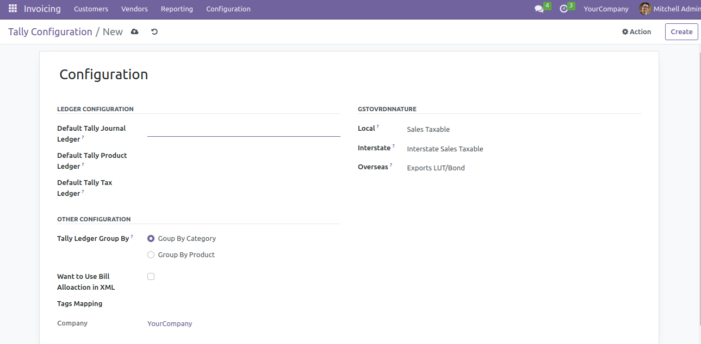

# TG Sugar ERP — Odoo 19 Customization Suite

  

A complete **sugar-factory ERP** customization suite on **Odoo 19** — featuring an **Odoo ↔ Tally connector** (XML-based invoice export/mapping), **tender purchase management**, **broker portals**, **party sales**, **automatic database backups** (customized OSS base) and UX hardening modules.

> **My contribution on this suite: debugging & support** — bug fixing, QA and small patches across these flows. Module authorship belongs to other developers; the modules are bundled here to showcase the delivery context and my debugging scope.

```
tg-sugar-erp/
├── odoo_tally_connector/       # Odoo ↔ Tally accounting connector (XML tags, field mapping, invoice export)
├── tender_booking/             # Tender purchase management using purchase orders
├── portal_broker/              # Broker allotment menus for partners & sale orders (portal)
├── sale_order_modifier_hmrc/   # Broker process on sale orders
├── party_sale_modifier_hmrc/   # "Party Sale Order" menu & flows
├── invoice_old_data/           # Store legacy Excel records on customer invoices (Old Records data tab)
├── auto_database_backup/       # Scheduled DB backups (Dropbox / OneDrive / GDrive / S3 / Nextcloud / FTP / SFTP)
├── hide_datetime/              # Hide time from all datetime fields globally
└── hide_menu_user/             # Hide any menu item, user-wise
```

## Highlights

- **Odoo ↔ Tally Connector**
  - Configurable **field mapping UI** between Odoo invoice data and Tally XML tags.
  - Invoice export engine (`tally_export_invoice.py`) generating Tally-compatible XML payloads.
  - Settings panel for server/URL, categories and export sequences.



- **Tender Booking** — tender-based purchase management with booking records, auction/tender references and supplier linking on purchase orders.
- **Broker & Party Sales** — broker allotment workflow (partners + sale orders), portal access, and dedicated Party Sale Order menus.
- **Auto Database Backup** — cron-drived backups, per-destination configuration with mail notifications (success/failure).

## Dependencies

`sale, purchase, account, hr, stock, web` (per-module, see each `__manifest__.py`)

## License

LGPL-3 (as declared in module manifests).
